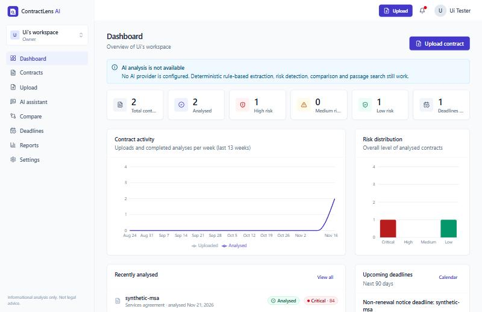
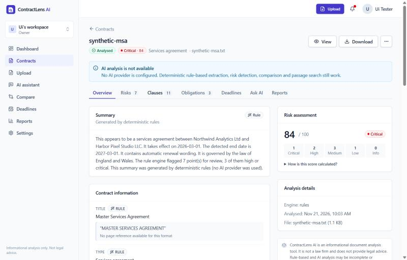
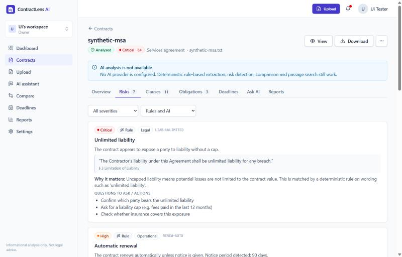
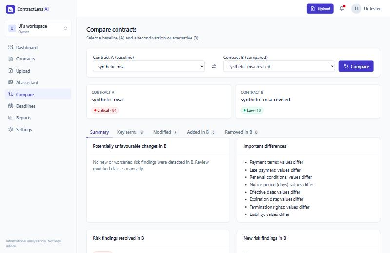
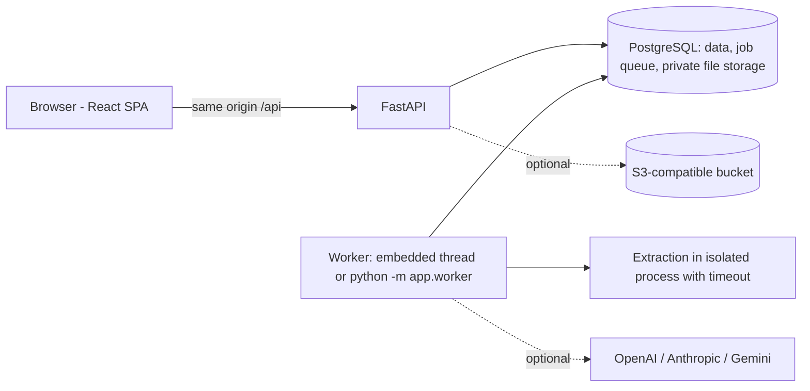

# ContractLens AI

**Contract intelligence for freelancers, small businesses and legal operations teams.** Upload a PDF, Word or text
contract and ContractLens extracts the key terms, flags clauses worth a closer look, tracks obligations and deadlines,
compares versions, and answers questions with citations to the document itself.

> ContractLens AI is an informational document analysis tool. It is **not a law firm and does not provide legal advice**.
> Automated and AI analysis may be incomplete or incorrect — verify important findings in the original document and have
> important legal decisions reviewed by a qualified legal professional.



| Contract overview | Risk findings with evidence | Version comparison |
| --- | --- | --- |
|  |  |  |

*Screenshots of the running application with synthetic test contracts.*

## Features

- **Accounts & workspaces** — registration, login, JWT access tokens with rotating refresh tokens (httpOnly cookie),
  password reset, profile, multiple workspaces with Owner / Administrator / Analyst / Viewer roles, invitations, audit log.
- **Contract management** — upload PDF, DOCX and TXT (signature, structure and size validation; macros and embedded
  content are never executed), rename, folders, full-text search, filters by status/risk/date, sorting, secure deletion,
  short-lived signed downloads, processing status.
- **Structured extraction** — title, type, parties, effective/expiration dates, term, renewal and notice period,
  governing law, jurisdiction, payment terms and deadlines, late-payment penalties, fees, price adjustment, ten key legal
  clause types and party obligations. Every value links to the sentence, clause and page it came from.
- **Transparent risk engine** — 30+ deterministic rules (unlimited liability, broad indemnities, auto-renewal, one-sided
  termination, long payment terms, high late interest, unilateral price/term changes, broad IP assignment, non-compete,
  exclusivity, data-protection gaps, placeholders, text addressed to AI tools, …) plus optional AI findings. Rule and AI
  findings are labelled; AI quotes are verified against the document and unverifiable ones are excluded from the score.
  The scoring formula is documented in the UI.
- **Document-grounded assistant** — BM25 retrieval over the selected contract only; with an AI provider the model may
  answer only from retrieved excerpts and every citation is verified, otherwise the answer is withheld. Without AI it
  returns the most relevant passages verbatim. Document text is treated as untrusted input (prompt-injection hardening).
- **Comparison** — key-term table, added / removed / modified clauses with word-level diffs and similarity scores,
  resolved/new/worsened risk findings. Clauses are called identical only when their normalised text is identical.
- **Deadlines** — expiration, non-renewal notice and dated obligations are added automatically; manual deadlines;
  month calendar; configurable reminders delivered in-app and by email when SMTP is configured.
- **Reports** — PDF, CSV (formula-injection safe) and JSON exports with source references and the legal disclaimer.
- **AI providers** — OpenAI, Anthropic and Google Gemini behind one provider-independent interface, configurable per
  server or per workspace (encrypted workspace keys). **The app is fully usable without any AI key.**

## Technology

| Layer | Stack |
| --- | --- |
| Backend | Python 3.12, FastAPI, Pydantic v2, SQLAlchemy 2, Alembic, PostgreSQL (psycopg 3), PyJWT, Argon2id |
| Documents | PyMuPDF (PDF + optional Tesseract OCR), python-docx, ReportLab (PDF reports) |
| Background jobs | Durable PostgreSQL-backed queue (`SELECT … FOR UPDATE SKIP LOCKED`), embedded or standalone worker — no Redis needed |
| Storage | Private PostgreSQL storage, S3-compatible object storage, or local disk (development) |
| Frontend | React 19, TypeScript, Vite, Tailwind CSS v4, shadcn-style components (Radix), TanStack Query, Recharts, Lucide, Sonner |
| Testing | pytest (SQLite + PostgreSQL), Vitest + Testing Library, end-to-end smoke script |
| Ops | Docker (single image), Docker Compose, Render Blueprint, GitHub Actions |

## Architecture



Analysis pipeline: validate upload → store privately → queue job → extract text per page (child process, hard timeout,
page/size limits, optional OCR) → segment clauses → deterministic extraction & risk rules → optional AI analysis
(structured JSON validated with Pydantic, quotes verified against the document) → transparent score → atomic save →
automatic deadlines → notification.

More detail: [INSTRUCTION.md](INSTRUCTION.md) (setup, configuration, deployment) · [SECURITY.md](SECURITY.md) ·
[PROJECT_REVIEW.md](PROJECT_REVIEW.md) (audit report) · [CHANGELOG.md](CHANGELOG.md).

## Quick start

**Windows:** double-click `Start App.bat`. **macOS:** double-click `Start App (Mac).command` (first time: right-click → Open).

The launchers check for Python 3.12+, Node.js 20+ and Docker, install dependencies, create `backend/.env` with fresh
secrets, start PostgreSQL in Docker, apply migrations and open http://localhost:5173.

Manual start:

```bash
docker compose up -d db
```

```bash
cd backend && python -m venv .venv && .venv/Scripts/pip install -r requirements-dev.txt   # macOS/Linux: .venv/bin/pip
```

```bash
cp .env.example backend/.env   # then set JWT_SECRET_KEY and ENCRYPTION_KEY
```

```bash
cd backend && .venv/Scripts/python -m alembic upgrade head && .venv/Scripts/python -m uvicorn app.main:app --port 8000
```

```bash
cd frontend && npm ci && npm run dev
```

Full stack in containers (API + web app + worker + database): `docker compose --profile full up --build` → http://localhost:8080.

## Configuration

All settings are environment variables — see [.env.example](.env.example). The most important:

| Variable | Purpose |
| --- | --- |
| `DATABASE_URL` | PostgreSQL connection string |
| `JWT_SECRET_KEY`, `ENCRYPTION_KEY` | Token signing and encryption of stored credentials (required in production) |
| `STORAGE_BACKEND` | `database` (default on Render), `s3` or `local` (+ `OBJECT_STORAGE_*` for S3) |
| `AI_PROVIDER` | `none`, `openai`, `anthropic` or `gemini`, with the matching `*_API_KEY` and optional `*_MODEL` |
| `SMTP_*` | Optional email for password resets, invitations and reminders |
| `MAX_UPLOAD_MB`, `MAX_PDF_PAGES`, `PROCESSING_TIMEOUT_SECONDS` | Upload and processing limits |

## Testing

```bash
cd backend && .venv/Scripts/python -m pytest
```

```bash
cd frontend && npm run lint && npm run typecheck && npm test && npm run build
```

```bash
backend/.venv/Scripts/python scripts/smoke_test.py http://localhost:8000
```

Backend tests run against SQLite by default and against PostgreSQL when `TEST_DATABASE_URL` is set (as in CI). AI
providers are mocked — no credentials or paid calls are needed. All test documents are synthetic.

## Deployment

The repository contains a Render Blueprint ([render.yaml](render.yaml)): one Docker web service (API + SPA + embedded
worker) and a Render PostgreSQL database that also stores documents privately. See
[INSTRUCTION.md › Deployment](INSTRUCTION.md#deployment-on-render) for the step-by-step guide, plan limits and
S3/worker options.

## Security notes

Workspace isolation enforced on every query, backend RBAC, Argon2id password hashing, rotating refresh tokens with
reuse detection, CSRF header on cookie endpoints, rate limiting and lockout, strict CSP and security headers, private
storage with signed 2-minute download links that re-check membership, encrypted workspace API keys, audit log without
document contents, retention policies and secure deletion. Details and limitations: [SECURITY.md](SECURITY.md).

## License

[MIT](LICENSE)
